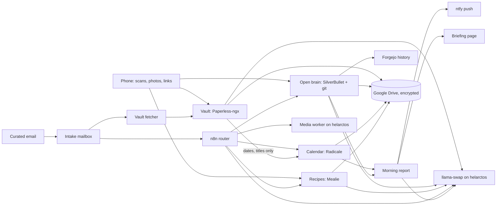

# Automation plans

Planning notes for the household AI services: apps and data on [space-needle](../../docs/hosts/space-needle.md), inference on [helarctos](../../docs/hosts/helarctos.md). **Everything here is proposed** unless a line says otherwise. Once something is built, its current state moves to `docs/services/<name>.md` and the plan page shrinks to the remaining work; delete a page when nothing is left.

These pages replace the [Home Second Brain proposal](https://claude.ai/artifact/EbMpmFyehGEkf5CyRf4reR) doc; its content is in [vault](vault.md), [open brain](open-brain.md) and [models](models.md).

## Use cases

| # | Use case | State | Page |
|---|---|---|---|
| 0 | Chat portal: Open WebUI on the GPU | Live | [workflows](workflows.md#chat) |
| 1 | Agentic coding | In progress ([#155](https://github.com/hsimah/the-loft/issues/155)) | [coding-agents](coding-agents.md) |
| 2a | Open brain: household wiki | Next | [open-brain](open-brain.md) |
| 2b | Vault: financial, medical, personal records | Next | [vault](vault.md) |
| 3 | Calendar, reminders and reports | Proposed | [calendar](calendar.md) |
| 4 | Recipes from email, photos and reels | Proposed | [recipes](recipes.md) |
| 5 | Custom AI workflows | n8n already runs (CPU) | [workflows](workflows.md) |

Cross-cutting: [shared services](shared-services.md) · [email intake](intake.md) · [off-site backups](backups.md) · [models and GPU sharing](models.md).

Planning: [roadmap](roadmap.md) · [decisions](decisions.md) · [names](names.md).

## How the pieces connect

Viking and fjord are not needed: every piece here wants space-needle's storage or helarctos's GPU, and Viking is the DMZ.

## Conventions

- One topic per page. Decisions live in [decisions.md](decisions.md) with an ID; topic pages refer to the ID instead of repeating the options.
- Link to Compose, host.conf and docs for exact images, ports and paths; don't copy them here.
- Label anything not checked on a live host as unverified.
