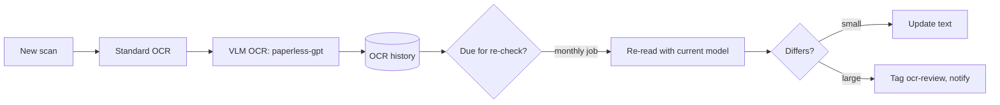

# Documents: Paperless in Mercurius

The document half of [Mercurius](mercurius.md): financial, medical and personal records, and any other document, in Paperless-ngx on the encrypted volume. Every document is searchable by content; the original is kept forever so its text can be re-read as models improve. Paperless with standard OCR is live today as Plutus ([service page](../../docs/services/plutus.md)); the move into Mercurius is on [Mercurius](mercurius.md#migration). This page holds the OCR, intake and backup work still to come.

## Stack

| Piece | Proposed | Notes |
|---|---|---|
| Archive | [Paperless-ngx](https://docs.paperless-ngx.com) 3.x | Keeps the original next to its text. 3.0 (July 2026) added opt-in AI: suggested title, tags, correspondent, type, dates; document chat; similar documents. `PAPERLESS_AI_LLM_BACKEND=openai-like` points it at llama-swap ([setup guide](https://wz-it.com/en/blog/paperless-ngx-ai-setup/)) |
| Helpers | Postgres, Redis, Tika, Gotenberg | Tika and Gotenberg let it consume `.eml` and office files from [intake](intake.md) |
| AI OCR | [paperless-gpt](https://github.com/icereed/paperless-gpt) | Vision-model OCR for messy scans via an OpenAI-compatible base URL; tag-triggered. **No login of its own**: anyone who reaches it can rewrite documents, so it stays on the vault's internal network with no Caddy route |
| Mail fetcher | `mercurius-fetch`, a small IMAP fetch container | Phase 4; see [intake](intake.md#vault-fetcher) |

Not Paperless-AI: unmaintained since March 2026, and Paperless's built-in AI covers it.

Paperless 3.3's AI does not fill custom fields and takes no custom prompts. Due and expiry dates for the [Janus](janus.md) therefore come from the linker job below, or from paperless-gpt if its pinned version supports custom fields.

## Isolation

- **Shared with the wiki.** Paperless and SilverBullet share the group, the encrypted volume and its internal networks ([Mercurius](mercurius.md#target)). Wiki pages may quote documents. One shared household archive (D4); Paperless permissions can split it later.
- **Encrypted at rest** (D5): LUKS2 on a 250 GB LVM volume on the NVMe, unlocked by hand after each boot. Everything, including Postgres with the OCR text, is on it, and nothing in the group starts while it is locked.
- **One route out.** Paperless and paperless-gpt reach `helarctos:8080` only, one way, through a bridge and nftables rule ([model egress](../../docs/services/plutus.md#model-egress)); the rest of the group is on internal networks. The mail fetcher is the one exception, in its own container.
- **Read from outside.** Open WebUI and n8n read documents through Caddy with an API token ([chat and n8n access](mercurius.md#chat-and-n8n-access)); what they store is outside the vault, an accepted risk.
- **No side doors.** Only the Paperless and SilverBullet UIs are routed through Caddy, LAN and Tailscale only. Never on the tunnel.
- **AI suggests, you approve.** Suggestions and review tags, never silent overwrites.
- **The AI machine stores nothing.** Documents pass through helarctos in memory. llama-swap at `logLevel: info` does not log request bodies (checked against a real ID document; see [the runbook](../../docs/services/plutus.md#built-in-ai)), and the hop is plain HTTP on the LAN.
- **Local models only**, never Claude.

## Getting documents in

Every document goes to Paperless, not into wiki attachments: the wiki holds notes and links, and SilverBullet does not index text inside images or PDFs.

1. **Phone or scanner**: upload through the web UI or a Paperless mobile app (over Tailscale off-LAN), or a scanner writing to the consume folder. Which scanner, if any, is open.
2. **OneDrive remainder**: retarget [onedrive-pull.sh](../../control-plane/onedrive-pull.sh) at a vault staging directory, then triage: documents to Paperless, everything else to general files. OneDrive is paid until May 2027.
3. **Email**: forward to the vault address ([intake](intake.md)).

## Scanning, OCR and re-checking

Every original is kept, so text can be re-read as models improve.

Three small custom pieces, in bash per repo rules:

- **OCR history table**: one row per reading: document, model and version, prompt, date, text.
- **Re-check job**: re-reads documents not checked for N months (D7) or read by an older model. Small differences update automatically; large ones get `ocr-review` and an [ntfy](shared-services.md) notice, because a disagreement between two readings is where mistakes hide.
- **Linker job**: proposes summaries, tags, links and custom-field dates for new documents, as suggestions.

Batch work follows the [GPU sharing rules](models.md#sharing-the-gpu).

## Backups

Built but shelved (2026-10-26): `document_exporter` output plus a Postgres dump, in an encrypted restic repository of its own. After the move the same job also takes the SilverBullet folder ([runbook](../../docs/operations/backups.md)). See [backups](backups.md).

## Open questions

- D6: what goes in first: tax and financial, medical, or IDs and certificates?
- D7: re-check interval: 3, 6 or 9 months?
- D8: who reviews flagged documents, and how are you notified?
- Is there a scanner with a document feeder, or is the phone the scanner?
