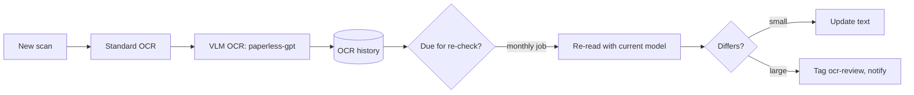

# Plutus: vault for sensitive records

A locked-down archive for financial, medical and personal records. Every document is searchable by content; the original scan is kept forever so its text can be re-read as models improve. This is the "Documents (proposed)" row in [maintenance](../../plans/maintenance.md), fed partly from the rest of OneDrive.

## Stack

| Piece | Proposed | Notes |
|---|---|---|
| Archive | [Paperless-ngx](https://docs.paperless-ngx.com) 3.x | Keeps the original next to its text. 3.0 (July 2026) added opt-in AI: suggested title, tags, correspondent, type, dates; document chat; similar documents. `PAPERLESS_AI_LLM_BACKEND=openai-like` points it at llama-swap ([setup guide](https://wz-it.com/en/blog/paperless-ngx-ai-setup/)) |
| Helpers | Postgres, Redis, Tika, Gotenberg | Tika and Gotenberg let it consume `.eml` and office files from [intake](intake.md) |
| AI OCR | [paperless-gpt](https://github.com/icereed/paperless-gpt) | Vision-model OCR for messy scans via an OpenAI-compatible base URL; tag-triggered. **No login of its own**: anyone who reaches it can rewrite documents, so it stays on the vault's internal network with no Caddy route |
| Mail fetcher | `plutus-fetch`, a small IMAP fetch container | Phase 4; see [intake](intake.md#vault-fetcher) |

Not Paperless-AI: unmaintained since March 2026, and Paperless's built-in AI covers it.

Paperless 3.3's AI does not fill custom fields and takes no custom prompts. Due and expiry dates for the [Janus](janus.md) therefore come from the linker job below, or from paperless-gpt if its pinned version supports custom fields.

## Isolation

- **Separate everything.** Own Compose group, database, storage and Docker network. Nothing flows from the vault into the wiki.
- **Encrypted at rest** (D5). Originals, archive, export and Postgres all live on the encrypted volume. Postgres holds the OCR text, so it can't stay on the unencrypted root disk like other services' `/opt` state.
- **No internet.** Egress only to `helarctos:8080`, one direction: the vault calls the model, never the reverse. Enforce it with an nftables rule on the vault bridge, like [kennl's](../../hosts/helarctos/kennl-egress.nft); this is a first case for [#104](https://github.com/hsimah/the-loft/issues/104)/[#106](https://github.com/hsimah/the-loft/issues/106). The mail fetcher is the one exception, in its own container.
- **No side doors.** Only the Paperless UI is routed through Caddy, LAN and Tailscale only. Never on the tunnel.
- **AI suggests, you approve.** Suggestions and review tags, never silent overwrites.
- **The AI machine stores nothing.** Documents pass through helarctos in memory; check llama-swap and llama-server don't log request bodies.
- **Local models only**, never Claude.

## Getting documents in

1. **Phone or scanner**: upload through the web UI or a Paperless mobile app (over Tailscale off-LAN), or a scanner writing to the consume folder. Which scanner, if any, is open.
2. **OneDrive remainder**: retarget [onedrive-pull.sh](../../control-plane/onedrive-pull.sh) at a vault staging directory, then triage: records to the vault, everything else to the wiki or general files. OneDrive is paid until May 2027.
3. **Email**: forward to the vault address ([intake](intake.md)).

## Scanning, OCR and re-checking

Every original is kept, so text can be re-read as models improve.

Three small custom pieces, in bash per repo rules:

- **OCR history table**: one row per reading: document, model and version, prompt, date, text.
- **Re-check job**: re-reads documents not checked for N months (D7) or read by an older model. Small differences update automatically; large ones get `ocr-review` and an [ntfy](shared-services.md) notice, because a disagreement between two readings is where mistakes hide.
- **Linker job**: proposes summaries, tags, links and custom-field dates for new documents, as suggestions.

Batch work follows the [GPU sharing rules](models.md#sharing-the-gpu).

## Backups

Paperless's `document_exporter` output plus a Postgres dump, into an encrypted restic repository of its own. See [backups](backups.md).

## Open questions

- D4: separate private areas for each of you, or everything shared?
- D6: what goes in first: tax and financial, medical, or IDs and certificates?
- D7: re-check interval: 3, 6 or 9 months?
- D8: who reviews flagged documents, and how are you notified?
- Is there a scanner with a document feeder, or is the phone the scanner?
