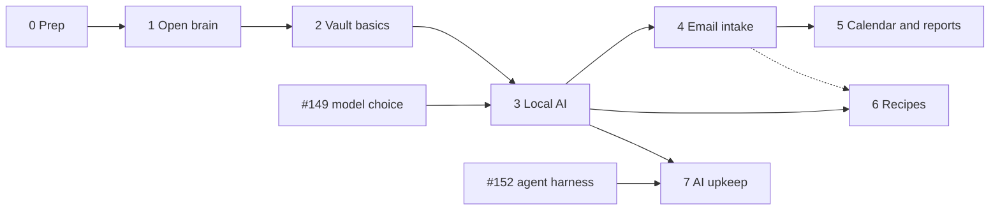

# Roadmap

The open brain comes first, so the rest of the work has somewhere to keep its notes. The vault follows straight away: digitising can start with plain OCR, and the AI can re-read everything later because originals are kept. Each phase ends at a usable state with a tested backup.

Recipes can run in parallel with phases 4–5 once phase 3 is done; only their email path waits for intake. Coding work ([#155](https://github.com/hsimah/the-loft/issues/155)) continues alongside and gates phases 3 and 7.

## Phase 0 — Prep

Decisions D0, D1, D9, D10, D11 ([decisions](decisions.md)).

- [ ] **Now:** Open WebUI pointed at llama-swap ([chat](workflows.md#chat)).
- [ ] Pick names.
- [ ] Check Google Drive quota and create the rclone Drive client (`drive.file`).
- [ ] Tailscale on both phones and laptops, and on space-needle.
- [ ] Write the backup recovery sheet template.

## Phase 1 — Open brain

[open-brain](open-brain.md) · decisions D2, D3, D19.

- [ ] Compose bundle with the `wiki` profile: SilverBullet plus the git sidecar; host.conf dirs and health URLs; Caddy LAN route; dnsmasq.
- [ ] Private wiki repo on Forgejo; deploy key for the sidecar.
- [ ] restic job for the wiki (the shared backup script lands here).
- [ ] Service page in `docs/services/`, README rows.

**Done when** both of you edit from phone and laptop, on and off the LAN; edits appear in Forgejo; a wiki snapshot restores from Drive.

## Phase 2 — Vault basics

[vault](vault.md) · decisions D4, D5, D6.

- [ ] Encrypted volume and its unlock procedure (runbook).
- [ ] Compose group: Paperless-ngx, Postgres, Redis, Tika, Gotenberg on a vault-only network; Caddy leg; egress firewall (deny all for now).
- [ ] Phone and scanner upload path; consume folder.
- [ ] Retarget the OneDrive puller to vault staging; triage.
- [ ] Exporter + Postgres dump into the vault restic repository; restore test.

**Done when** the first record category is scanned and searchable, and a vault restore from Drive works with only the recovery sheet.

## Phase 3 — Local AI

[models](models.md) · [workflows](workflows.md) · decisions D8, D18, D21. Needs #149's choice for D18.

- [ ] Household models on llama-swap (OCR, small instruct, embeddings, whisper) with resident groups; batch slot agreed with the runner.
- [ ] Vault egress: allow helarctos `:8080` only; probe that nothing else leaves.
- [ ] Paperless AI suggestions and index; paperless-gpt OCR on the internal network.
- [ ] n8n repointed at llama-swap; Ollama retired (Open WebUI moved in phase 0).
- [ ] ntfy as a Houstn `notify` profile.

**Done when** a new scan gets vision-model OCR and suggestions, and the egress probe passes.

## Phase 4 — Email intake

[intake](intake.md) · decision D12.

- [ ] Intake account, labels, filters, app password; forwarding rules in the main Gmail.
- [ ] Shared sender-check helper (bash).
- [ ] Vault fetcher container; n8n router for `wiki`, `cal`, `recipe`.

**Done when** a forwarded bill reaches the Paperless inbox, a forwarded note reaches the wiki `inbox/`, and mail from an unlisted sender is rejected and logged.

## Phase 5 — Calendar and reports

[calendar](calendar.md) · decisions D13, D14.

- [ ] Radicale profile; `household`, `proposed` and `tasks` collections; phone setup.
- [ ] n8n extraction from `+cal` mail into `proposed`.
- [ ] Vault date exporter (title + link).
- [ ] Morning, weekly and monthly reports; ntfy push; on-demand webhook.

**Done when** the October example report is produced from real data.

## Phase 6 — Recipes

[recipes](recipes.md) · decisions D15, D16, D17, D22.

- [ ] Mealie profile, AI pointed at llama-swap.
- [ ] Media worker on helarctos; reel script.
- [ ] n8n path for `+recipe` mail.

**Done when** a reel link becomes an editable recipe with a photo.

## Phase 7 — AI upkeep

[vault](vault.md#scanning-ocr-and-re-checking) · [open-brain](open-brain.md#llm-wiki-agent) · decision D7.

- [ ] OCR history table, re-check job, `ocr-review` flags.
- [ ] Vault linker job (summaries, tags, due and expiry dates).
- [ ] Wiki agent on the #152 harness, opening PRs.
- [ ] Benchmark OCR models and backends on your own documents; tune the re-check interval.

## Next actions

1. Point Open WebUI at llama-swap (D0).
2. Answer D1, D2, D9, D10 and D11.
3. Then the phase 1 Compose bundle can be drafted here for review.
