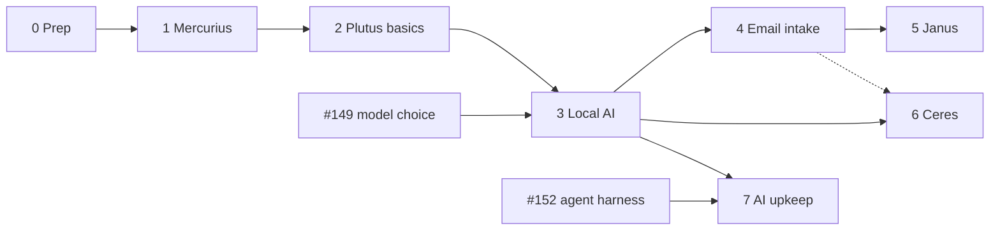

# Roadmap

Mercurius, the open brain, comes first, so the rest of the work has somewhere to keep its notes. Plutus, the vault, follows straight away: digitising can start with plain OCR, and the AI can re-read everything later because originals are kept. Each phase ends at a usable state with a tested backup. Backups are shelved since 2026-10-26 ([backups](backups.md)), so the backup lines below stay open and their "done when" restores are deferred.

**Current priority** (ahead of the order below): local LLMs, first OCR in Plutus, then importing and parsing in Mercurius. Both need phase 3 pieces: the models downloaded and served on llama-swap, and, for Plutus, a one-way path from the vault to `helarctos:8080`.

Recipes can run in parallel with phases 4–5 once phase 3 is done; only their email path waits for intake. Coding work ([#155](https://github.com/hsimah/the-loft/issues/155)) continues alongside and gates phases 3 and 7.

## Phase 0 — Prep

Decisions D0, D1, D9, D10, D11 ([decisions](decisions.md)).

- [x] Open WebUI pointed at llama-swap ([chat](workflows.md#chat)).
- [x] Names: Mercurius (wiki), Plutus (vault), Janus (calendar), Ceres (recipes).
- [ ] Check Google Drive quota and create the rclone Drive client (`drive.file`).
- [ ] Tailscale on both phones and laptops, and on space-needle.
- [x] Write the backup recovery sheet template ([runbook](../../docs/operations/backups.md#recovery-sheet)); print it, fill it in and file it.

## Phase 1 — Mercurius

[Mercurius](mercurius.md) · decisions D2, D3, D19.

- [x] Compose, host.conf dirs and health URL, Caddy LAN route (the loft wildcard already resolves).
- [x] Deploy; accounts and the `household` space; Forgejo repo with SilverBullet's deploy key ([setup](../../docs/services/mercurius.md#setup)).
- [ ] restic job for the wiki: built and shelved ([backups](backups.md)).
- [x] Service page in `docs/services/`, README rows.

**Done when** both of you edit from phone and laptop, on and off the LAN; edits appear in Forgejo; a wiki snapshot restores from Drive.

## Phase 2 — Plutus basics

[Plutus](plutus.md) · decisions D4, D5, D6.

- [x] Encrypted volume and its unlock procedure ([runbook](../../docs/services/plutus.md)).
- [x] Compose group: Paperless-ngx, Postgres, Valkey, Tika, Gotenberg on internal networks only; Caddy joins `plutus-proxy`.
- [x] Deploy: create the volume, start Plutus, accounts with two-factor, egress probe.
- [ ] Move the LUKS header backup to the USB stick in the safe; recovery sheet filed.
- [ ] Phone and scanner upload path; consume folder.
- [ ] Retarget the OneDrive puller to vault staging; triage.
- [ ] Exporter + Postgres dump into the vault restic repository: built and shelved; restore test deferred.

**Done when** the first record category is scanned and searchable, and a vault restore from Drive works with only the recovery sheet.

## Phase 3 — Local AI

[models](models.md) · [workflows](workflows.md) · decisions D8, D18, D21. Needs #149's choice for D18.

- [ ] Download the OCR models and compare them on your own scans: GLM-OCR and PaddleOCR-VL-1.5 are configured in llama-swap (persistent `ocr` group), not yet fetched or measured ([commands](../../docs/services/sputnik.md#ocr-models)). First, ahead of the rest of the set.
- [ ] Household models on llama-swap (OCR, small instruct, embeddings, whisper) with resident groups; batch slot agreed with the runner.
- [ ] Vault egress: allow helarctos `:8080` only; probe that nothing else leaves.
- [ ] Paperless AI suggestions and index; paperless-gpt OCR on the internal network.
- [ ] Mercurius attachment OCR job ([plan](mercurius.md#ocr-for-attachments)).
- [x] Ollama retired; n8n has no workflows yet (Open WebUI moved in phase 0).
- [ ] ntfy as a Houstn `notify` profile.

**Done when** a new scan gets vision-model OCR and suggestions, and the egress probe passes.

## Phase 4 — Email intake

[intake](intake.md) · decision D12.

- [ ] Intake account, labels, filters, app password; forwarding rules in the main Gmail.
- [ ] Shared sender-check helper (bash).
- [ ] `plutus-fetch` container; n8n router for `wiki`, `cal`, `recipe`.

**Done when** a forwarded bill reaches the Paperless inbox, a forwarded note reaches the wiki `inbox/`, and mail from an unlisted sender is rejected and logged.

## Phase 5 — Janus

[Janus](janus.md) · decisions D13, D14.

- [ ] Janus: Radicale with the git hook and `janus-git`; users and rights; `household`, `proposed` and `tasks` collections; phone setup.
- [ ] n8n extraction from `+cal` mail into `proposed`.
- [ ] Vault date exporter (title + link).
- [ ] Morning, weekly and monthly reports; ntfy push; on-demand webhook.

**Done when** the October example report is produced from real data.

## Phase 6 — Ceres

[Ceres](ceres.md) · decisions D15, D16, D17, D22.

- [ ] Ceres: Mealie, AI pointed at llama-swap.
- [ ] Media worker on helarctos; reel script.
- [ ] n8n path for `+recipe` mail.

**Done when** a reel link becomes an editable recipe with a photo.

## Phase 7 — AI upkeep

[Plutus](plutus.md#scanning-ocr-and-re-checking) · [Mercurius](mercurius.md#llm-wiki-agent) · decision D7.

- [ ] OCR history table, re-check job, `ocr-review` flags.
- [ ] Vault linker job (summaries, tags, due and expiry dates).
- [ ] Wiki agent on the #152 harness, opening PRs.
- [ ] Benchmark OCR models and backends on your own documents; tune the re-check interval.

## Next actions

1. Plutus OCR: download the OCR model and serve it on helarctos; open the vault-to-helarctos path; paperless-gpt on the internal network (phase 3). Needs D18 and [#149](https://github.com/hsimah/the-loft/issues/149).
2. Mercurius import and parsing: the attachment OCR job ([plan](mercurius.md#ocr-for-attachments)), then what else to import and parse.
3. Plan backups for space-needle and helarctos as a whole, then revisit Drive ([backups](backups.md)).
4. Answer D9 (Tailscale) and D19.
