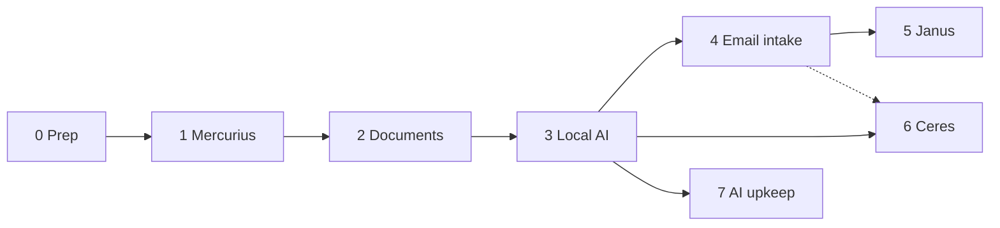

# Roadmap

[Mercurius](mercurius.md) holds the wiki and the document archive together on the encrypted volume: SilverBullet is the index, Paperless keeps the documents. Digitising starts with plain OCR, and the AI can re-read everything later because originals are kept. Each phase ends at a usable state with a tested backup. Backups are shelved since 2026-10-26 ([backups](backups.md)), so the backup lines below stay open and their "done when" restores are deferred.

**Current priority** (ahead of the order below): local LLMs and OCR in Paperless and the Mercurius merge (both done), then [chat and n8n access](mercurius.md#chat-and-n8n-access) to the wiki and documents. Email intake and web clippings wait: chat with wiki write tools covers them for now.

Recipes can run in parallel with phases 4–5 once phase 3 is done; only their email path waits for intake. Local coding ([#155](https://github.com/hsimah/the-loft/issues/155)) is deferred; household work has the GPU (D18).

## Phase 0 — Prep

Decisions D0, D1, D9, D10, D11 ([decisions](decisions.md)).

- [x] Open WebUI pointed at llama-swap ([chat](workflows.md#chat)).
- [x] Names ([names](names.md)).
- [ ] Check Google Drive quota and create the rclone Drive client (`drive.file`).
- [ ] Tailscale on both phones and laptops: route, split DNS and grants on space-needle, which is already enrolled ([plan](tailscale.md)).
- [x] Write the backup recovery sheet template ([runbook](../operations/backups.md#recovery-sheet)); print it, fill it in and file it.

## Phase 1 — Mercurius

[Mercurius](mercurius.md) · decisions D2, D3, D19.

- [x] Compose, host.conf dirs and health URL, Caddy LAN route (the loft wildcard already resolves).
- [x] Deploy; accounts and the `home` space; Forgejo repo with SilverBullet's deploy key ([setup](../services/mercurius.md#setup)).
- [ ] restic job for the wiki: built and shelved ([backups](backups.md)).
- [x] Service page in `docs/services/`, README rows.
- [x] Merge with Paperless onto the encrypted volume: one group, `wiki.` and `paperless.` hostnames, git sync off, revisions kept. Live 2026-10-29 ([service page](../services/mercurius.md)).
- [ ] Paperless preview widget in the wiki ([plan](mercurius.md#preview-widget)).

**Done when** both of you edit from phone and laptop, on and off the LAN; the wiki runs from the vault with its revisions; a vault snapshot restores from Drive.

## Phase 2 — Documents

[Documents](documents.md) · decisions D4, D5, D6.

- [x] Encrypted volume and its unlock procedure ([runbook](../services/mercurius.md)).
- [x] Compose group: Paperless-ngx, Postgres, Valkey, Tika, Gotenberg on internal networks only; Caddy joins `plutus-proxy`.
- [x] Deploy: create the volume, start Paperless (as Plutus), accounts with two-factor, egress probe.
- [ ] Move the LUKS header backup to the USB stick in the safe; recovery sheet filed.
- [ ] Phone and scanner upload path; consume folder.
- [ ] Retarget the OneDrive puller to vault staging; triage.
- [ ] Exporter + Postgres dump into the vault restic repository: built and shelved; restore test deferred.

**Done when** the first record category is scanned and searchable, and a vault restore from Drive works with only the recovery sheet.

## Phase 3 — Local AI

[models](models.md) · [workflows](workflows.md) · decisions D8, D18, D21.

- [x] OCR models on llama-swap: `glm-ocr` and `paddleocr-vl` in the persistent `household` group ([OCR models](../services/sputnik.md#ocr-models)). Not yet scored on a sample set.
- [ ] Household models resident on llama-swap: the 35B text, OCR and embedding models in the persistent `household` group (D18, [models](models.md#sharing-the-gpu)); whisper is not yet.
- [x] Vault egress: helarctos `:8080` only, for Paperless and paperless-gpt ([model egress](../services/mercurius.md#model-egress)). The hop is plain HTTP until Tailscale (D9).
- [x] paperless-gpt second-pass OCR, on demand by tag ([runbook](../services/mercurius.md#second-pass-ocr)).
- [ ] Paperless's built-in AI ([built-in AI](../services/mercurius.md#built-in-ai)): suggestions and chat work; slow.
- [ ] Chat and n8n tools for the wiki and documents ([plan](mercurius.md#chat-and-n8n-access)): document search and read, the Household model and code interpreter off are live; wiki tools next.
- [x] Ollama retired; n8n has no workflows yet (Open WebUI moved in phase 0).
- [ ] ntfy as a Houstn `notify` profile.

**Done when** a new scan gets vision-model OCR and suggestions, and the egress probe passes.

## Phase 4 — Email intake

[intake](intake.md) · decision D12.

- [ ] Intake account, labels, filters, app password; forwarding rules in the main Gmail.
- [ ] Shared sender-check helper (bash).
- [ ] `mercurius-fetch` container; n8n router for `wiki`, `cal`, `recipe`.

**Done when** a forwarded bill reaches the Paperless inbox, a forwarded note reaches the wiki `inbox/`, and mail from an unlisted sender is rejected and logged.

## Phase 5 — Janus

[Janus](janus.md) · decisions D13, D14.

- [ ] Janus: Radicale with the git hook and `janus-git`; users and rights; `household`, `proposed` and `tasks` collections; phone setup.
- [ ] n8n extraction from `+cal` mail into `proposed`.
- [ ] Vault date exporter (title + link).
- [ ] Morning, weekly and monthly reports; ntfy push; on-demand webhook.

**Done when** the October example report is produced from real data.

## Phase 6 — Ceres

[Ceres](ceres.md) · decisions D15, D16, D17, D22.

- [ ] Ceres: Mealie, AI pointed at llama-swap.
- [ ] Media worker on helarctos; reel script.
- [ ] n8n path for `+recipe` mail.

**Done when** a reel link becomes an editable recipe with a photo.

## Phase 7 — AI upkeep

[Documents](documents.md#scanning-ocr-and-re-checking) · [Mercurius](mercurius.md#later) · decision D7.

- [ ] OCR history table, re-check job, `ocr-review` flags.
- [ ] Vault linker job (summaries, tags, due and expiry dates).
- [ ] Overnight wiki upkeep as an n8n workflow.
- [ ] Benchmark OCR models and backends on your own documents; tune the re-check interval.

## Next actions

1. Wiki tools for chat ([plan](mercurius.md#chat-and-n8n-access)); the document tools are live.
2. Plan backups for space-needle and helarctos as a whole, then revisit Drive ([backups](backups.md)).
3. Answer D9 (Tailscale).
